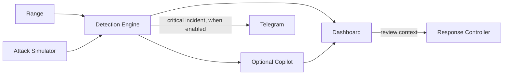

# Bantis

**Version 1.0.0**

Bantis is a self-hosted supply-chain security lab. It runs an instrumented CI/CD range, replays controlled attack scenarios, correlates events into incidents, and presents evidence in a local dashboard. An optional AI Copilot can analyze incidents and suggest next steps. A separate Response Controller applies its own deterministic policy and approval rules.

Bantis is designed for one trusted operator and one local environment. It is not a general-purpose network intrusion detection system or a multi-tenant service.

## What is included

| Component | Purpose |
| --- | --- |
| [Range](range/README.md) | FastAPI, PostgreSQL, Redis, and Nginx application stack with structured event logging. |
| [Attack Simulator](attack-sim/README.md) | Four supply-chain scenarios: malicious dependency, leaked secret, compromised CI step, and typosquatting. |
| [Detection Engine](detection-engine/README.md) | Event ingestion, three correlation patterns, incident API, scorecard, and optional Telegram alerts for critical incidents. |
| [Gap Detector](gap-detector/README.md) | Compares saved attack-sim history with persisted incidents, reports detection gaps, and suggests inactive scenario-based correlation drafts. |
| [AI Copilot](ai-copilot/README.md) | Optional Claude-based incident analysis and follow-up answers. Recommendations do not execute actions. |
| [Dashboard](dashboard/README.md) | Setup wizard, service orchestration, live logs, incidents, evidence, live feed, audit history, and optional response review. |
| [Response Controller](response-controller/README.md) | Host-local policy, approval, execution, stop, rollback, and audit controls, separate from Copilot. |



The wizard starts the managed Docker Compose services. The Dashboard itself runs on the host and does not receive the Docker socket. The Response Controller remains a host-local tool with its own state and authorization.

## Quick start

### Requirements

- Linux host with Docker Engine and Docker Compose v2 available to the account running the Dashboard.
- Python 3.12 or newer for the Dashboard host process.
- A private host state directory outside the repository.
- Range credentials in `range/.env` if you plan to start the Range services. You can omit Range by setting `DASHBOARD_ORCHESTRATION_RANGE=false`.

The managed stack binds published service ports to loopback. Do not expose the Detection Engine directly to an untrusted network: event ingestion is not authenticated.

### Prepare Range configuration

If you want the Range in the managed stack, create `range/.env` from the example, replace every placeholder with private values, and restrict the file to the owner:

```bash
test -e range/.env || cp range/.env.example range/.env
chmod 600 range/.env
```

Edit `range/.env` before continuing. Keep database credentials, Redis credentials, JWT keys, and connection strings consistent. These existing Range settings are not copied into the Dashboard secret store. To run only platform services, set `DASHBOARD_ORCHESTRATION_RANGE=false` instead.

### Start the Dashboard

From the repository root:

```bash
python3 -m venv dashboard/.venv
dashboard/.venv/bin/python -m pip install -r dashboard/requirements.txt

export DASHBOARD_STATE_DIR="$HOME/.local/state/bantis-dashboard"
export DASHBOARD_ORIGIN=http://127.0.0.1:8200
export DASHBOARD_ORCHESTRATION_ENABLED=true
export DASHBOARD_TOKEN="$(python3 -c 'import secrets; print(secrets.token_urlsafe(32))')"

cd dashboard
.venv/bin/python -m uvicorn bantis_dashboard.main:create_app --factory --host 127.0.0.1 --port 8200 --workers 1
```

Open **http://127.0.0.1:8200/setup**. Create the administrator account, sign in, and follow the setup steps:

1. Choose permissions explicitly. Capabilities start disabled.
2. Select Claude and test/save a provider key, or choose **No AI**.
3. Test/save Telegram or skip it.
4. Choose **Start all configured services** and wait for health checks.

The state directory and encryption key must remain private and available across restarts. Back up the key separately from encrypted configuration. See [administrator setup and encrypted storage](dashboard/README.md#administrator-setup) and [orchestration details](dashboard/README.md#service-orchestration-and-live-logs) for recovery, port settings, and security details.

The Dashboard opens at **http://127.0.0.1:8200/**. Use the navigation for **Overview**, **Live feed**, **Incidents**, **Audit log**, and **Setup**. The service startup status and live container logs are under **Setup → Start Services**.

## Telegram incident alerts

When **Allow Telegram messages** is enabled and tested Telegram credentials are saved, the Detection Engine sends alerts for incidents whose severity is `critical`. Current high-severity incidents remain visible in the Dashboard without Telegram messages. Failed or uncertain deliveries remain in a persistent outbox for retry. The feature is optional; Telegram credentials are stored encrypted locally and read-only by the managed Detection Engine.

## Run an attack scenario

Attack simulations change files and may invoke local tools such as Git or `pip`. Use a disposable local lab and review the scenario cleanup instructions first. The explicit safety setting is required before a scenario can run:

```bash
cd attack-sim
export BANTIS_ENV=range-local
python cli.py list
python cli.py run malicious-dependency
```

See [Attack Simulator usage and safety notes](attack-sim/README.md#safety-barrier-bantis_env) for the other scenarios, forwarding events, and recovery commands. Starting services does not run attack simulations.

## Security boundaries and limitations

- **Single trusted operator.** Keep the Dashboard on loopback or behind authenticated TLS. The setup administrator is not the Response Controller approval credential.
- **Unauthenticated event ingestion.** The Detection Engine assumes a local trusted environment. Forged events can create misleading incidents; do not publish its API to an untrusted network.
- **Supply-chain scope.** Detection depends on instrumented services emitting events. Bantis does not detect activity that produces no supported event and is not a network IDS. See the [threat model](docs/threat-model.md).
- **Optional external providers.** Selecting Claude sends the Copilot's allowlisted incident evidence to Anthropic and may incur charges. No AI is a supported configuration. Telegram alerts contact Telegram only when configured and permitted.
- **Recommendations do not execute.** Copilot output is untrusted review context. The controller derives proposals from incident facts and uses separate policy, approvals, and host credentials. Automatic promotion holds are a narrow, separately configured controller option; the setup wizard does not enable them. See [controller security guarantees](docs/response-controller-security.md).
- **Local audit limits.** Hash-chained local history detects inconsistent records but does not prevent a privileged host user from replacing the files. Independent audit anchoring is an operator responsibility.
- **Not multi-tenant.** The managed stack is intended for one trusted operator on one local host.

## Verification

Install the dependencies for the component you are checking, then follow its test instructions:

- [Dashboard tests and browser flow](dashboard/README.md#verify)
- [Detection Engine tests](detection-engine/README.md#running-the-tests)
- [Gap Detector tests](gap-detector/README.md#validation)
- [Attack Simulator tests](attack-sim/README.md#running-the-tests)
- [Copilot tests](ai-copilot/README.md#running-the-tests)
- [Response Controller tests](response-controller/README.md#running-the-tests)
- [Cross-component integration tests](tests/README.md)

The end-to-end browser smoke test uses disposable fixture services and does not send real Telegram messages. The optional Docker orchestration smoke test builds a temporary stack, checks health and event ingestion, and removes only its own containers and database volume. It requires a running Docker daemon and may download images/dependencies:

```bash
python3 dashboard/scripts/browser_smoke.py --python "$PWD/dashboard/.venv/bin/python" --admin-setup
dashboard/.venv/bin/python dashboard/scripts/orchestration_smoke.py
```

For installation and component-specific run commands, use the linked READMEs. Design references and security decisions are collected under [`docs/`](docs/).

Use the [Purple Team loop](docs/purple-team-loop.md) to review an M2 scenario
that produces no M3 incident, record the detection gap, assign remediation,
and verify the original conditions before closure.