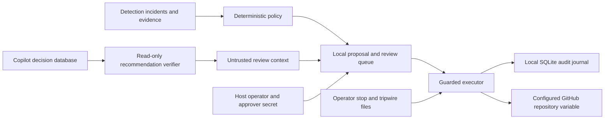
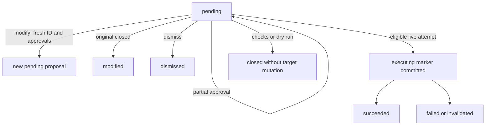

# Response Controller Design: Whitelist, Approval Flow, Kill Switch

## Status and scope

The controller implements local review, bounded automatic promotion holds,
verified execution, rollback, and a local hash-chained audit journal.
[ADR 0006](adr/0006-response-actions-and-kill-switch.md) remains **Proposed**.
Authenticated event ingestion, external audit anchoring, and deployment isolation
are still outstanding gates. All actions ship disabled, dry run is the default,
and automatic mode is off.

This document describes current behavior and labels planned capabilities
separately. The [component guide](../response-controller/README.md) contains
configuration and command examples. The AI Copilot remains recommend-only under
[ADR 0004](adr/0004-recommend-only-default.md).

## Responsibilities and trust boundaries



Policy, review, and execution are logical responsibilities within the controller,
not independently isolated services. The local CLI has no approval HTTP endpoint.
Dedicated OS users and filesystem permissions must be provisioned at deployment.
The controller neither imports an AI provider SDK nor executes model descriptions.

| Responsibility | Implementation | Authority |
|---|---|---|
| Fetch evidence | [incident_client.py](../response-controller/incident_client.py) | Read-only detection API |
| Choose an action | [incident_policy.py](../response-controller/incident_policy.py) | Validated incident fields and exact evidence membership |
| Join analysis for display | [bridge.py](../response-controller/bridge.py), [recommendations.py](../response-controller/recommendations.py) | Read-only decision database; no action selection authority |
| Queue and review | [approval_flow.py](../response-controller/approval_flow.py), [cli.py](../response-controller/cli.py) | Trusted host access; approval decisions additionally require an operator secret |
| Enforce execution rules | [executor.py](../response-controller/executor.py), [config.py](../response-controller/config.py) | Enabled implementation, approvals or exact automatic scope, readable stop state |
| Apply and undo effects | [promotion_hold.py](../response-controller/actions/promotion_hold.py), [rollback.py](../response-controller/rollback.py) | Configured repository credential and audited rollback state |

Recommendation absence, provider failure, confidence, and prose do not select or
suppress a policy action. A corrupt decision database deliberately stops `sync`
and trips execution and AI stops. Model prose can still influence a human reading
it; separation guarantees concern the executable policy path. Event ingestion is
currently unauthenticated: schema-valid facts do not prove their producer.

## Action catalog and policy

The closed [catalog](../response-controller/catalog.py) fixes tiers. Configuration
cannot introduce an unknown action or implement a catalog entry. Tier A means
eligible for an explicitly configured scope, not automatic by default.

| Action | Tier | Current implementation |
|---|---|---|
| `hold_promotion` | A | Set the fixed `BANTIS_PROMOTION_HOLD` variable without replacing an existing hold |
| `lift_promotion_hold` | B | Delete the configured repository's hold after approval |
| `rollback_action` | B | Restore the saved target state through a separate review |
| `preserve_evidence` | A | Catalog only; additive evidence storage is planned |
| `notify_channel` | A | Catalog only; operator notifications are planned |
| `rollback_latest` | B | Catalog only; controller dispatch of the existing CI rollback workflow is planned |
| `block_client_ip` | B | Catalog only; generated nginx deny rules and expiry are planned |

Hold and lift accept only empty parameters. The repository and variable are not
selected by incident prose or advice. Rollback accepts an original action ID and
snapshot hash; its target comes from the audited snapshot and must match current
repository API configuration. Arbitrary commands, credentials, deletion of data,
source edits, service stops, and host firewall changes remain outside the catalog.
Changing the catalog requires an ADR amendment.

The current policy proposes only `hold_promotion`:

- `A3:composite-success`: a `composite-dependency-secret` incident with exactly
  two correlated `attack-sim` scenario events, one malicious dependency and one
  leaked secret, with at least one scenario status `success`.
- `A3:untrusted-registry`: an `untrusted-registry-pull` incident with one image
  pull event and a nonempty registry outside `docker.io` and `ghcr.io`.

Evidence IDs must exactly match correlated IDs without duplicates. Future-dated
incidents produce no proposal. Action IDs are deterministic per incident; the
one-hour execution window starts at incident creation, not synchronization.
The default automatic rule is `A3:composite-success`; a registry proposal needs
manual approval unless its exact rule is selected in automatic configuration.

## Proposal and approval lifecycle

### A proposal

[Proposal and Approval](../response-controller/models.py) carry action and
incident IDs, type, scalar parameters, policy rule, timezone-aware creation and
expiry times, and approval count. `proposal_hash` is recomputed from canonical
JSON of every proposal field; it is not a supplied authorization token.

The CLI authenticates `approve`, `modify`, `dismiss`, and `rollback` using the
current OS identity and `RESPONSE_APPROVER_SECRET_FILE`. This must be a nonempty,
operator-owned regular file with no group or other permission bits; 0600 and
0400 are documented examples. Secrets are prompted for, not passed as arguments.
Reads, ordinary submission, automatic execution, and emergency stopping rely on
trusted host access.

Approval must match the action ID and at least 12 hash characters, fall inside
the proposal's review window, and come from distinct approvers. The default
window is 60 minutes. Multiple CLI approvals require distinct OS identities;
a shared account does not provide two-person approval.



`approved` and `undone` are not stored queue states. Executor outcomes are
`refused`, `awaiting_approval`, `expired`, `invalidated`, `dry_run`, `succeeded`,
and `failed`. Awaiting approval keeps a proposal pending. Expired proposals are
filtered from `pending` and rejected on review without a background status
rewrite. A dry run closes its proposal; a live attempt needs a new one.

`modify` changes parameters only, retaining type, incident, rule, expiry, and
approval count; replacements inherit no approvals. Rollback proposals cannot be
modified. Context can be refreshed without changing the proposal or replaying a
completed action. Execution checks current target preconditions; it does not
re-fetch the incident to prove it is still valid at approval time.

## Execution and concurrency

The executor applies these steps in order:

1. Record the request. Require a catalog type, implementation, explicit
   enablement, and strictly validated parameters.
2. Reject already attempted IDs and expired proposals. Reject any supplied
   approval for a different proposal hash.
3. Read the effective stop state. Require enough distinct approvals unless the
   exact automatic scope applies and automatic execution is allowed. Partial
   manual approval cannot fall back to automatic execution.
4. Check current target preconditions and calculate the read-only plan.
   Preconditions that fail or raise invalidate without acting.
5. In dry run, record the plan and stop. Reads and journal writes still occur;
   target mutations and automatic reservations do not.
6. Reserve an automatic slot if needed. Commit `executing` before effects.
7. Recheck the stop, capture and persist rollback state, then recheck the stop
   and captured target state before executing reversible actions.
8. Record execution, run the read-only post-check, and record verification and
   the outcome. Execution or post-check failures trip execution off.

The review flow holds a host file lock through execution. Journal appends and
automatic reservations use SQLite write transactions. These serialize cooperating
processes sharing a journal and lock file. Direct callers of `Executor` must
provide equivalent serialization; the executor alone is not a distributed lock.

An `executing` marker prevents replay even after a crash before the effect.
This is **at-most-once attempt protection**, not an exactly-once remote
transaction. A remote change may happen before an error or failed audit write.
Inspect incomplete attempts and their targets rather than retrying the original
ID. A pre-effect audit failure blocks the effect; a post-effect failure reports
failure and trips the switch without automatically undoing the effect.

## Automatic scope and limits

| Implemented control | Behavior |
|---|---|
| Enabled actions | Empty by default; unknown names fail configuration |
| Automatic action | Off by default; only `hold_promotion` is accepted |
| Scope | Exact configured repository, policy rule, and one required approval |
| Rate | Default 5 attempts per rolling hour; configurable from 1 to 5 |
| Identity | One automatic reservation per action or incident across recorded history |
| Exhausted rate | Trip `auto-off` and require approval |
| Existing hold | Keep it; a new hold normally invalidates rather than replacing it |

Reservations count attempts, including crashes and failed effects, not just
successes. Future timestamps count against the budget to resist host clock
rollback. Preconditions and dry runs consume no slot. These local-journal
limits do not impose cross-host quotas or limits on manually approved actions.

The previously proposed limits of 20 pending proposals, 10 notifications per
hour, one notification per incident, and two image rollbacks per day are roadmap
requirements, not enforced controls. Notification summaries, evidence retention,
promotion-history selection, IP expiry, and action-specific review windows
also depend on unimplemented actions.

## Rollback

A rollback is a compensating proposal with its own ID, hash, expiry, approvals,
execution, and verification. An authenticated request supplies the executed
proposal's hash prefix and a reason. The new proposal binds to the original
action and the entry hash of its pre-execution snapshot. `show` includes saved
state for review. It retains the original approval count and always requires
fresh approval, including when undoing an automatic hold.

Undoing a hold restores the previous absence or value; undoing a lift restores
the exact removed value. Changed API targets or unrelated current values block
rollback. An already restored target succeeds without writing. Checks repeat
after snapshot capture and before execution, but GitHub variable operations do
not offer a conditional delete: external writers still need coordination.

Repeated requests reuse a pending rollback. Once a rollback reaches `executing`,
another request cannot replay it. Dismissed, expired, and dry-run proposals can
be requested again. A completed rollback can itself be rolled back after review.
Expired originals and partial failures with saved state remain eligible.
Legacy executions without snapshots require manual recovery. Restoring a hold
cannot undo downstream releases promoted while it was absent. Future actions
need tested snapshot, prepared-execution, and compensation hooks.

## Audit journal

`reviews.sqlite3` stores proposals, approvals, and ordered events. Events include
proposal identity and hash, executor and initiator identities, per-event UTC
times, attempt IDs, approvals, plans, structured outcomes, verification, and
rollback links. Reversible live attempts add `rollback_prepared` before writing.
A crash can leave an incomplete attempt.

```text
entry_hash = SHA256(sequence + "\n" + previous_hash + "\n" + exact_json_payload)
```

Appends verify the event chain inside the write transaction. History and audit
exports also verify it. `audit-verify --expected-head` compares the current head
with a separately retained checkpoint. Migration baselines legacy events; it
does not invent historical identities or authenticity.

The chain is neither encryption nor a signature. Local verification alone
cannot prevent an administrator from rebuilding it, replacing the journal, or
deleting a valid tail. `verify()` does not independently hash-chain proposal and
approval tables. Protect the entire database and state directory. Independent
checkpoint retention and external anchoring remain required by G2.

## Kill switch and recovery

| Effective state | Implemented effect |
|---|---|
| `clear` | Configured approval and automatic scope rules apply |
| `auto-off` | Automatic execution stops; approved actions can still execute |
| `execution-off` | No target mutations; proposals can still be queued |
| Independent `ai_off: true` | The Copilot's model-call path stops; controller execution still follows its execution level |

`kill-switch` contains the operator stop and `kill-switch.tripped` contains
tripwires. The stronger level wins; AI-off flags are combined. Missing or corrupt
operator state, or an unreadable or corrupt existing tripwire, fails closed to
execution off and AI off. An absent tripwire is normal. Writers use atomic file
replacement and a directory lock; their APIs cannot lower an existing stop.

Guards recheck before effectful steps, not every read-only request. A remote call
already in flight may finish. `python3 cli.py emergency-stop` sets execution off
and AI off without an approver secret, independently of invalid action settings.
Stopping precedes its audit attempt: a nonzero exit can mean the stop succeeded
but auditing failed. A writable state directory is still required. If even the
tripwire cannot be persisted, a critical log cannot guarantee a durable stop.

There is **no authenticated `resume` command yet**. Manual recovery is described
in the component guide. A stop does not globally invalidate stored approvals;
pending partial approvals can remain. Inspect targets and incomplete attempts,
review or dismiss pending approvals, and create fresh proposals as needed before
restoring execution. Authenticated resume with automatic approval invalidation
remains planned.

Implemented tripwires cover automatic rate exhaustion, execution and post-check
failures, audit write/integrity failures on the execution path, and a corrupt
Copilot decision log during `sync`. Token-budget-based AI stops and engagement
notifications are planned, not controller guarantees.

## Gates before live deployment

| Gate | Current position and remaining work |
|---|---|
| G1: authenticated event ingestion | Outstanding; forged schema-valid events can cause holds when execution is enabled |
| G2: externally anchored audit | Local chain and checkpoint comparison exist; independent anchoring and retention remain |
| G3: process, OS, and capability separation | Component separation exists; provision accounts, permissions, and scoped repository credentials at deployment |
| G4: kill switch implemented and drilled | Automated tests exist; drill the actual deployment before enabling actions |
| G5: disabled by default | Implemented; per-action enablement and dry run remain operator decisions |

The proposed rollout starts with reviewed documentation and dry runs, then
manual holds, then scoped automatic holds after the gates and deployment drill.
Catalog-only actions need implementation, tests, credential review, and staging
rehearsal. Passing local tests does not establish that a deployment met the gates.
