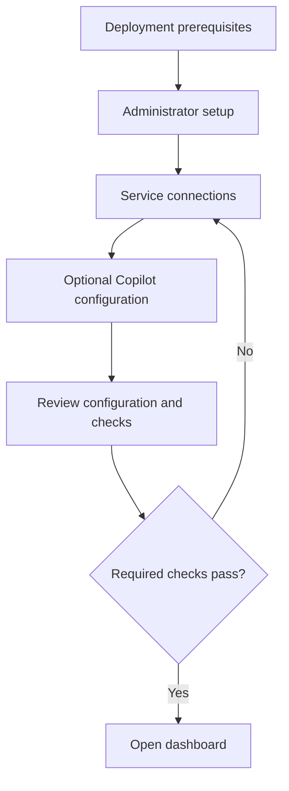

# Setup Wizard and Dashboard Design

**Status:** Draft baseline; final layout freeze awaits the agreed diagrams.

This document defines the UI requirements supported by the current Bantis
contracts. The [dashboard foundation](../dashboard/README.md) now provides an
initial interface, local dashboard sessions, read-only incident access, selected
evidence, and periodic WebSocket status updates. Wizard setup authentication and
browser response approval remain unimplemented. All interface copy and
documentation must be in English.

## Design references and freeze criteria

The agreed wizard and dashboard diagrams are not present in the repository.
Their screen order, navigation, layout, and visual treatment cannot yet be
recorded as approved. The flow below is a proposal for comparison with those
references, not a replacement for them.

| Reference | Required before freeze |
|---|---|
| Wizard diagram | Stable file or link, revision, and agreed step order |
| Dashboard diagram | Stable file or link, revision, and agreed screen layouts |
| Design review | Reviewer, review date, and resolution of deviations |

To freeze the design, attach the references, reconcile the proposed flow and
screen responsibilities below against them, and complete the
[review checklist](wizard-dashboard-review.md). Record the accepted revision
here. Subsequent layout or flow changes must update both documents and the
affected diagram references together.

## Product boundaries

- Target one operator and one environment, consistent with the
  [threat model](threat-model.md).
- Keep setup administration separate from response authorization. A future
  wizard administrator account must not implicitly grant controller approval.
- Preserve recommend-only Copilot behavior under
  [ADR 0004](adr/0004-recommend-only-default.md). Model recommendations are
  context; deterministic controller policy selects executable actions.
- Display the configured response mode accurately: actions disabled by default,
  dry run by default, automatic execution off unless explicitly configured.
  Finishing setup must not enable live response.
- Keep unsupported controls unavailable with an explanation. A UI design does
  not accept [ADR 0006](adr/0006-response-actions-and-kill-switch.md) or close
  its deployment gates.

## Proposed setup flow

The diagram describes logical responsibilities only. Exact step count,
grouping, and placement await the agreed wizard diagram.

| Responsibility | Required behavior |
|---|---|
| Prerequisites | Explain the single-environment scope and check required services; identify failed checks individually. |
| Administrator setup | Define a future authenticated setup boundary; do not reuse the range application account or controller approver secret. |
| Service connections | Validate addresses and connectivity; distinguish reachable, unavailable, and unconfigured services. Connectivity alone does not prove authentication or deployment readiness. |
| Copilot configuration | Allow setup without a provider key. Explain which allowlisted incident data leaves the host for the configured provider and that provider usage has a cost. |
| Configuration review | Show connection results, Copilot availability, and response defaults without exposing credentials. Clearly identify blocking errors and optional omissions. |
| Completion | Open the dashboard only after required setup checks succeed; show an explicit unavailable state for optional services. |

Back navigation preserves non-sensitive inputs. Failed validation keeps the
operator on the relevant step with an actionable English message. Duplicate
submissions must not create duplicate administrator accounts or configuration
writes. Persistence, secret storage, setup locking, session authentication, and
recovery after interruption require backend contracts before implementation.
Credentials must not appear in review summaries, URLs, browser logs, or durable
browser storage; configuration responses must return redacted values.

## Proposed dashboard responsibilities

These are information requirements, not an approved page inventory or layout.
The agreed dashboard diagram must determine whether they appear as pages,
panels, or drawers.

| Area | Information and behavior |
|---|---|
| Environment summary | Environment identity, service availability, last successful refresh, response mode, and effective stop state. Do not equate a health check with security readiness. |
| Incident list | Severity, summary, pattern, MITRE techniques, detection confidence, and creation time. Support the existing severity, pattern, and since filters, with pagination and total matching count. |
| Incident detail | Incident identity, immutable detection facts, and correlated evidence ordered by timestamp and event ID. Preserve list filters and pagination when returning from detail. |
| Copilot context | Recorded reasoning, separately labeled AI confidence, and recommendation. Distinguish absent analysis, deferred or skipped analysis, provider outage, and stored analysis failure using authoritative backend state. |
| Follow-up questions | Display recorded questions and answers in order; allow questions only when recorded analysis exists and the authenticated endpoint is available. Replies do not create executable actions. |
| Response review | Exact controller proposal ID and hash, action, target, parameters, policy rationale, expiry, approval requirements, execution mode, and verified outcome. Keep AI context visually separate from the executable proposal. |
| Audit and recovery | Recorded decisions, attempts, verification, and rollback eligibility. Do not present a local hash chain as independently anchored evidence. |

Display explicit time zones. Distinguish a zero incident count from an unavailable
query. Do not label detection rate, false positives, or MTTD as live dashboard
metrics without a defined evaluation run, ground truth, and a retrieval contract.
Never invent incident resolution states: the current incident API is read-only.

## Response interactions

Browser approval is a future capability. Until an authenticated controller API
exists, response controls must identify the local CLI workflow and remain
unavailable in the browser. See the
[controller guide](../response-controller/README.md) for supported operations.

Future Approve, Modify, and Dismiss interactions must preserve exact proposal
binding, required identities, expiry, reasons, and fresh approval after a
modification. Re-fetch state after decisions; an expired or replaced proposal
must never appear successfully approved. A dry run is labeled **Dry run**,
separately from verified live success. Rollback requires its own authenticated
proposal, saved snapshot, and fresh approvals; it is not a one-click reset.

Show `auto-off`, `execution-off`, and the independent `ai_off` state separately.
An emergency stop must not wait for an approval dialog; report whether durable
stopping succeeded and whether audit recording failed. An in-flight remote
request may still finish. Do not offer browser resume while authenticated
resume and approval invalidation remain unimplemented.

## Data sources and implementation gaps

| UI need | Existing source | Remaining work |
|---|---|---|
| Incident list and detail | Detection Engine `GET /incidents`, `GET /incidents/{id}` through the dashboard session boundary | Local browser access is implemented; upstream authentication remains open. See [query guide](../detection-engine/README.md). |
| Correlated evidence | Detection Engine `GET /incidents/{id}/events` through the dashboard | Selected fields render as text behind a dashboard session; raw messages and tool output are omitted. |
| Recorded initial analysis | Copilot decision log; local controller bridge reads recorded context | Define authenticated retrieval; do not expose the SQLite file to the browser. |
| Follow-up conversation | Copilot `GET` and `POST /incidents/{id}/questions` | Browser session integration; existing service bearer tokens stay server-side. See [Copilot guide](../ai-copilot/README.md). |
| Setup and administrator | No setup backend | Define first-run locking, credentials, configuration persistence, and session lifecycle. |
| Response state, review, audit, stop, rollback | Local controller CLI and journal | Define authenticated HTTP contracts and preserve [controller guarantees](response-controller-security.md). |
| Evaluation metrics | Local scorecard generator | Define evaluation result retrieval and provenance before displaying metrics. |

Detection routes currently have no authentication. Do not expose them beyond
localhost as part of a dashboard rollout without closing that gap. Browser
authentication must be designed across all services rather than inferred from
the existing range application login.

## Shared presentation requirements

Every data area needs distinct loading, empty, error, and stale states. Preserve
the last successful data on refresh failure with a visible timestamp and error;
do not replace it with fabricated zeros. Define refresh cadence during backend
integration rather than implying instantaneous correlation.

Use keyboard-accessible controls, visible focus, associated field labels, and
text status labels in addition to color. Preserve reading order on narrow
screens; allow wide evidence tables to scroll without hiding review details.
Render evidence, incident summaries, and model output as untrusted text, without
executing embedded markup. Visual dimensions, typography, colors, and responsive
breakpoints remain pending the agreed diagrams.
